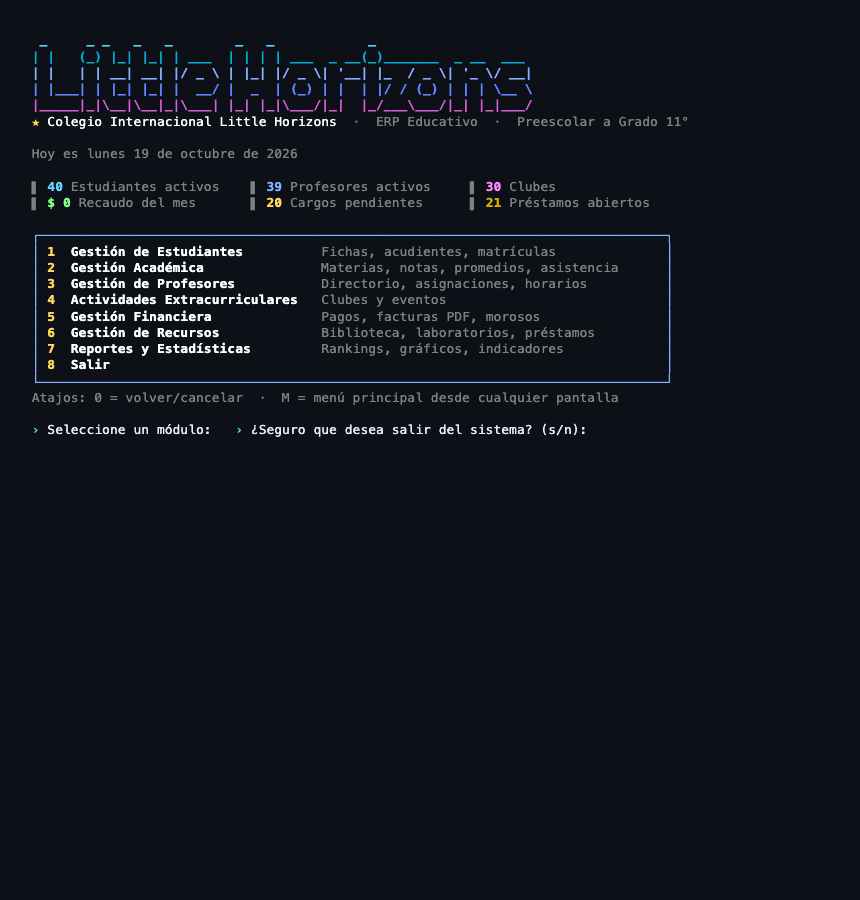
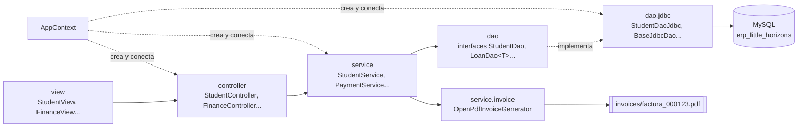
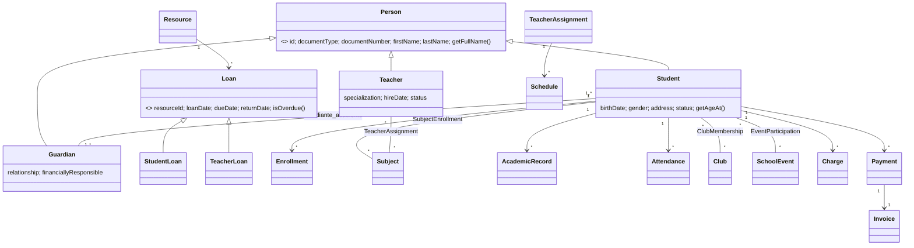
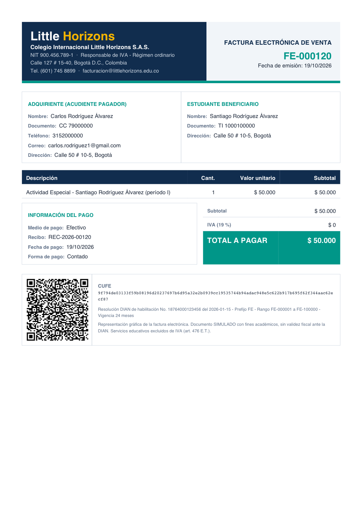
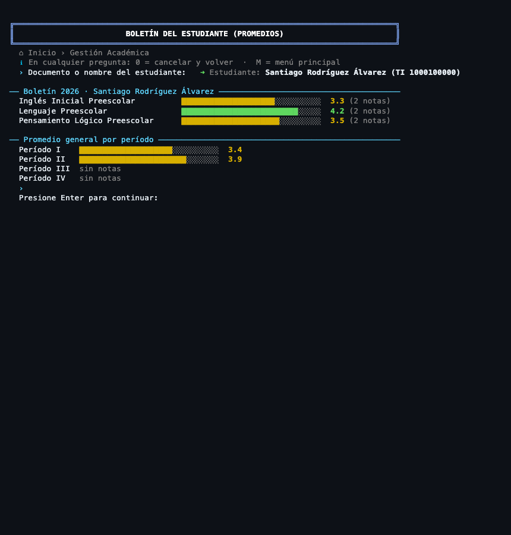
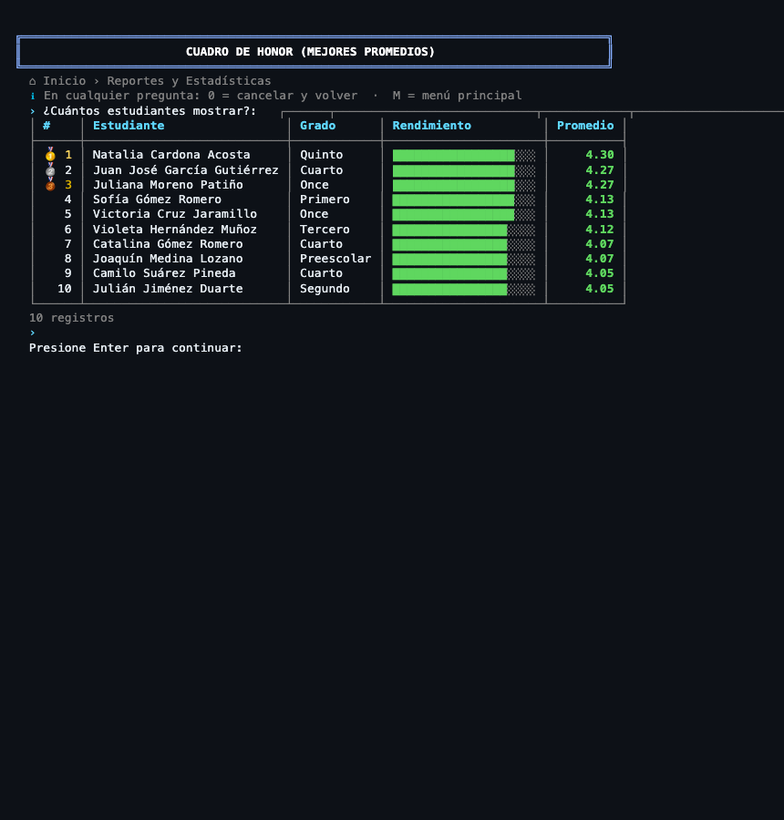
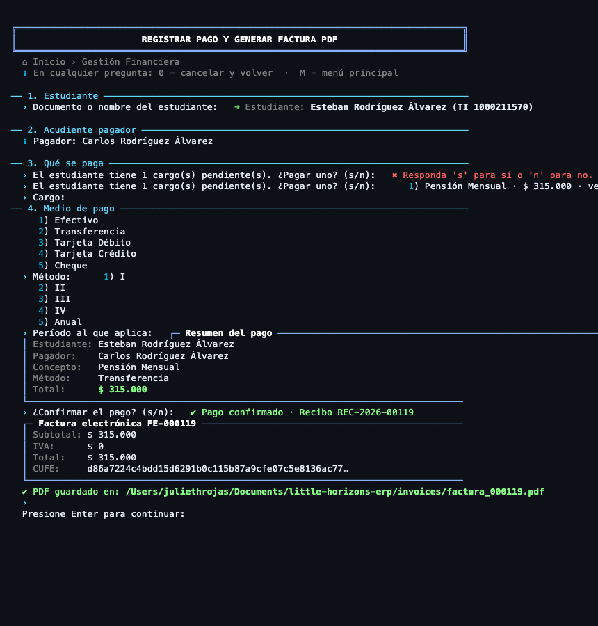

# Little Horizons ERP

Sistema de Planificación de Recursos Empresariales (ERP) educativo en consola para el **Colegio Internacional Little Horizons**: más de 500 estudiantes, 40 profesores, de preescolar a grado 11°.



## Descripción

Little Horizons ERP reemplaza los registros en papel y las hojas de cálculo dispersas por un único sistema que centraliza los procesos del colegio:

- **Académicos:** estudiantes, acudientes, matrículas, materias, profesores, horarios, calificaciones, promedios y asistencia.
- **Extracurriculares:** clubes con control de cupos y eventos con podio.
- **Financieros:** conceptos de pago, descuentos y becas, cargos, pagos, reporte de morosos y **factura electrónica PDF simulada según la DIAN** (CUFE + código QR).
- **Recursos:** inventario de biblioteca y laboratorios, préstamos a estudiantes y profesores y reporte de vencidos.
- **Reportes:** cuadro de honor, estudiantes en riesgo, distribución de desempeño, ingresos y más, con gráficos de barras en consola.

## Autores

- **Julieth Rojas** · Desarrolladora · [@juliethrojas755-beep](https://github.com/juliethrojas755-beep)

## Tecnologías

| Tecnología | Versión | Uso |
|---|---|---|
| Java | 17 | Lenguaje (Java estándar, sin frameworks) |
| Maven | 3.9+ | Construcción y dependencias |
| MySQL | 8.0 o superior | Base de datos `erp_little_horizons` |
| MySQL Connector/J | 8.4.0 | Driver JDBC |
| OpenPDF | 1.3.43 | Generación del PDF de facturas |
| ZXing | 3.5.3 | Código QR de la factura |

## Requerimientos previos

- **JDK 17** o superior.
- **MySQL 8.0 o superior** (obligatorio: el esquema usa restricciones `CHECK`, que MySQL solo aplica desde la versión 8.0.16).
- **Maven 3.9+** (o el Maven integrado de NetBeans o VS Code).
- Una consola con UTF-8. Se recomienda la terminal de VS Code, la del sistema o la ventana Output de NetBeans.

## Configuración de la base de datos

### 1. Crear la base de datos con datos de prueba

```bash
mysql -u root -p < docs/database.sql
```

El script `docs/database.sql` tiene dos secciones:

1. **DDL:** basado en el script oficial v2.0, con los cambios justificados al inicio del archivo (tablas `horarios`, `descuentos_estudiante` y `cargos`, columnas de totales en `facturas` y `anio_academico` sin "ñ").
2. **DML:** datos realistas de Colombia con integridad referencial: 40 estudiantes, 34 acudientes, 40 profesores, 36 materias, 240 registros académicos, 118 pagos con sus facturas, 30 clubes, 40 recursos, horarios sin conflictos, préstamos vencidos y morosos para probar los reportes.

> ⚠️ El script empieza con `DROP DATABASE IF EXISTS erp_little_horizons`: borra la base anterior.

### 2. Credenciales

Edite `src/main/resources/database.properties`:

```properties
db.url=jdbc:mysql://localhost:3306/erp_little_horizons?useSSL=false&allowPublicKeyRetrieval=true&serverTimezone=America/Bogota&characterEncoding=UTF-8
db.user=root
db.password=SU_CONTRASEÑA
```

Si prefiere no guardar la contraseña en el archivo, puede pasarla al ejecutar con `-Ddb.password=...`. Los argumentos de la JVM tienen prioridad sobre el archivo.

### 3. Driver JDBC

No hay que descargar nada a mano: Maven descarga `com.mysql:mysql-connector-j` (declarado en `pom.xml`) la primera vez que compila. Igual ocurre con OpenPDF y ZXing.

## Instalación y ejecución

```bash
git clone https://github.com/juliethrojas755-beep/little-horizons-erp.git
cd little-horizons-erp
mvn clean compile
mvn exec:java
```

**NetBeans:** `File › Open Project`, elegir la carpeta del proyecto (NetBeans lo reconoce como proyecto Maven por el `pom.xml`) y presionar **Run** (F6). La clase principal ya está configurada en el `pom.xml` (`exec.mainClass`).

**VS Code:** abrir la carpeta con la extensión *Extension Pack for Java*, abrir `Main.java` y presionar **Run**, o ejecutar `mvn exec:java` en la terminal integrada.

**Colores:** si su consola no interpreta códigos ANSI, ejecute con `-Dlh.colors=false` (o defina la variable `NO_COLOR`).

**Navegación:** en cualquier pregunta, `0` cancela y vuelve al menú anterior y `M` regresa al menú principal.

## Estructura del proyecto (MVC)

```
src/main/java/com/littlehorizons/erp/
├── Main.java              Punto de entrada: verifica la BD y abre el menú
├── AppContext.java        Raíz de composición: crea y conecta DAOs, servicios y controladores
├── model/                 MODELO: entidades y enums (sin lógica de base de datos)
│   ├── enums/             Estados mapeados al texto en español de la BD (DbEnum)
│   └── dto/               Records inmutables para reportes y resultados
├── dao/                   ACCESO A DATOS: interfaces (StudentDao, LoanDao<T>...)
│   └── jdbc/              Implementaciones JDBC: TODO el SQL vive aquí
├── service/               REGLAS DE NEGOCIO: cupos, promedios, morosos, horarios...
│   ├── discount/          Strategy de descuentos (hermanos, becas)
│   └── invoice/           Factura: CUFE, QR, IVA y PDF
├── controller/            CONTROLADORES: reciben la acción de la vista y responden OperationResult
├── view/                  VISTAS: menús y pantallas de consola por módulo
│   └── components/        ConsoleUI, TablePrinter y Menu reutilizables
└── util/                  Conexión, logger, lectura y validación de entradas, formatos
```

### Diagrama de capas



### Diagrama de clases del dominio



**Flujo de una petición:** `View → Controller → Service → DAO → MySQL`. Cada capa solo conoce a la de abajo y siempre a través de interfaces.

- La vista **no tiene reglas de negocio**: lee, llama al controlador e imprime.
- El controlador **no tiene SQL**: delega en el servicio y convierte cualquier excepción en un `OperationResult`.
- El servicio **no conoce JDBC**: usa interfaces DAO.
- El DAO **solo tiene SQL**, siempre con `PreparedStatement` y `try-with-resources`.

## Principios SOLID con ejemplos del código

| Principio | Dónde se ve | Explicación |
|---|---|---|
| **S** · Responsabilidad única | `AcademicService`, `AttendanceService`, `PaymentService`, `ErrorLogger`, `CufeGenerator` | Cada clase tiene un solo motivo de cambio: si cambia cómo se calcula el CUFE, solo se toca `CufeGenerator`. |
| **O** · Abierto/cerrado | `DiscountStrategy` + `DiscountStrategyFactory` | Un nuevo tipo de descuento es una clase nueva; `PaymentService.quote()` no se modifica. |
| **L** · Sustitución de Liskov | `Person` → `Student`, `Guardian`, `Teacher`; `Loan` → `StudentLoan`, `TeacherLoan` | `ResourceService.createLoan()` recibe cualquier `Loan` y funciona igual con ambos tipos. `BaseJdbcDao.mapPerson()` llena cualquier `Person`. |
| **I** · Segregación de interfaces | `ReadDao<T>` vs `CrudDao<T>` | Los catálogos (`GradeLevelDao`, `ResourceCategoryDao`) solo exponen lectura; nadie puede llamar `delete` sobre ellos. |
| **D** · Inversión de dependencias | Constructores de los servicios, `AppContext`, `InvoiceDocumentGenerator` | Los servicios reciben interfaces (`StudentDao`, `TransactionManager`). `PaymentService` depende de `InvoiceDocumentGenerator`, no de OpenPDF. |

## Patrones de diseño con justificación

| Patrón | Clase | Por qué |
|---|---|---|
| **Singleton** | `DatabaseConnection`, `ErrorLogger` | Una sola configuración de conexión y un solo punto de escritura del log (con `synchronized` para que dos escrituras no se mezclen). La conexión devuelve un `Connection` nuevo por operación para cerrarlo con try-with-resources. |
| **DAO** | `dao/` y `dao/jdbc/` | Aísla el SQL. Cambiar MySQL por otra fuente solo afecta esta capa. |
| **Factory** | `DaoFactory`, `DiscountStrategyFactory` | Centraliza la creación de implementaciones; el resto del código pide interfaces. |
| **Strategy** | `PercentageDiscountStrategy`, `SiblingDiscountStrategy` | Cada descuento calcula a su manera. El de hermanos solo aplica si el hermano sigue activo. |
| **Template Method** | `BaseJdbcDao`, `AbstractLoanDaoJdbc` | El esqueleto JDBC (abrir, preparar, ejecutar, mapear, cerrar) se escribe una vez. Los préstamos de estudiantes y profesores comparten todo el SQL y solo cambian tabla y columna. |
| **Unit of Work / Transacción** | `TransactionManager`, `JdbcTransactionManager` | Pago + cargo saldado + factura, o préstamo + estado del recurso, se guardan juntos o no se guarda nada (commit/rollback). |

## Funcionalidades por módulo

1. **Gestión de Estudiantes:** registro con acudiente obligatorio, varios acudientes por estudiante y hermanos con el mismo acudiente, ficha completa (datos médicos, contactos de emergencia, hermanos, historial de matrículas), matrícula por grado y año (una por año) y cambio de estado.
2. **Gestión Académica:** materias por grado, inscripción por período (individual o todas las del grado), notas de 0.0 a 5.0 con un decimal, nota final calculada, **boletín** con promedio por materia y por período (barras de color), promedio del curso por materia, historial completo agrupado por año y período, asistencia diaria y **patrones de inasistencia** (más de 3 ausencias en una semana).
3. **Gestión de Profesores:** directorio, búsqueda por especialización, asignación de materias (muchos a muchos), horarios con **validación de conflictos** de profesor y de salón, y vista de horario semanal en cuadrícula.
4. **Actividades Extracurriculares:** clubes con **validación de cupo** y barra de ocupación, inscripción y retiro, eventos por tipo, participantes y posiciones (1°, 2° y 3° únicos por evento).
5. **Gestión Financiera:** conceptos de pago, descuentos por hermanos y becas (se aplica el mejor), cargos pendientes, registro de pago con **factura PDF** (consecutivo, CUFE SHA-384, QR, IVA del 19 % solo para uniformes y resolución DIAN simulada), historial por estudiante y por acudiente, reporte de morosos con días de mora y regeneración del PDF.
6. **Gestión de Recursos:** catálogo por estado, mantenimiento y baja, préstamos con máximo 3 abiertos por estudiante, bloqueo si tiene vencidos, devolución que deja el recurso Disponible y reporte de vencidos de estudiantes y profesores.
7. **Reportes y Estadísticas:** cuadro de honor, estudiantes en riesgo, distribución según la escala del Decreto 1290, promedio y matrícula por grado, ingresos por concepto y por mes, pagos por método, carga docente, medallero e inventario. Todos se calculan con **Stream API** (`groupingBy`, `mapping`, `reducing`, `counting`, `sorted`, `EnumMap`, `TreeMap`).

### Factura electrónica



Ejemplo completo: [`docs/factura_ejemplo.pdf`](docs/factura_ejemplo.pdf). Al confirmar un pago se genera `invoices/factura_000123.pdf` y el sistema muestra la ruta absoluta. El PDF incluye la razón social *Colegio Internacional Little Horizons S.A.S.*, NIT, dirección, teléfono y correo, los datos del acudiente pagador y del estudiante, el número consecutivo, la fecha, el detalle, el subtotal, el IVA y el total, el CUFE, el código QR y la resolución de habilitación.

## Javadoc

Todas las clases están documentadas. Para generar la documentación HTML:

```bash
mvn javadoc:javadoc
# abrir target/reports/apidocs/index.html
```

## Manejo de errores y logs

- **Validación en la entrada:** `InputReader` repite la pregunta hasta recibir un dato válido (números en rango, fechas `AAAA-MM-DD`, notas con un decimal, correos, documentos).
- **Reglas de negocio:** los servicios lanzan `BusinessException` con un mensaje claro para el usuario (cupo lleno, conflicto de horario, nota inválida...).
- **Base de datos:** `BaseJdbcDao` captura `SQLException`, la registra con su stack trace y la convierte en `DataAccessException` con un mensaje entendible (por ejemplo, el código 1062 se traduce como "Ya existe un registro con ese dato único").
- **Controladores:** `BaseController.execute()` es el único `try-catch` de la capa. Convierte cualquier excepción en `OperationResult.fail(...)`, así la vista nunca se cae.
- **Log:** `ErrorLogger` escribe en **`error_log.txt`** con fecha, nivel (`ERROR`, `WARN`, `INFO`), clase de origen y stack trace, usando `try-with-resources` sobre un `BufferedWriter` en modo *append*.

```
[2026-10-19 15:33:09] [WARN ] [TeacherController] Conflicto de horario: el profesor ya tiene clase el Martes de 07:00 a 08:00.
[2026-10-19 15:33:09] [INFO ] [PaymentService] Payment REC-2026-00119 confirmed, invoice FE-000119
```

## Capturas

| Boletín del estudiante | Cuadro de honor |
|---|---|
|  |  |

| Registro de pago con factura |
|---|
|  |

## Problemas conocidos

- Algunas consolas (por ejemplo, versiones antiguas de la ventana Output de NetBeans) no interpretan colores ANSI ni emojis. Use `-Dlh.colors=false`.
- La factura es una **simulación académica**: el CUFE y la resolución no tienen validez ante la DIAN.
- Los estudiantes de preescolar usan `TI` porque el ENUM oficial no incluye registro civil (`RC`).

## Futuras mejoras

- Autenticación con roles (rectoría, secretaría, docentes).
- Envío de la factura por correo al acudiente.
- Exportación de reportes a Excel o PDF.
- Pruebas unitarias con JUnit para los servicios.

## Licencia

Proyecto académico de uso educativo. © 2026 Julieth Rojas.

## Contacto

Julieth Rojas · GitHub [@juliethrojas755-beep](https://github.com/juliethrojas755-beep)
