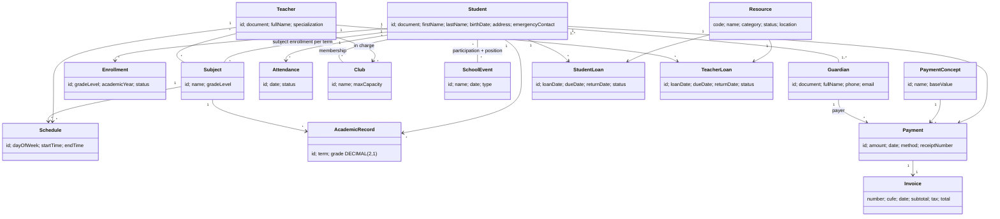

# Propuesta de arquitectura - Little Horizons ERP

## 1. Estructura de paquetes (Maven)

```
little-horizons-erp/
├── pom.xml                      (Java 17, MySQL driver, OpenPDF, ZXing)
├── CLAUDE.md
├── README.md
├── docs/database.sql
├── invoices/                    (PDFs generados)
├── error_log.txt                (se genera en ejecución)
└── src/main/java/com/littlehorizons/erp/
    ├── Main.java                (solo arranca el menú principal)
    ├── model/                   (entidades POJO + enums)
    │   ├── enums/               (GradeLevel, EnrollmentStatus, Term, AttendanceStatus,
    │   │                         PaymentMethod, ResourceCategory, ResourceStatus, LoanStatus,
    │   │                         EventType, EventPosition, MembershipStatus)
    │   ├── Student, Guardian, Teacher, Subject, Enrollment, SubjectEnrollment,
    │   │   AcademicRecord, Attendance, Schedule
    │   ├── Club, ClubMembership, SchoolEvent, EventParticipation
    │   ├── PaymentConcept, StudentConceptDiscount, Payment, Invoice, InvoiceLine
    │   └── Resource, StudentLoan, TeacherLoan
    ├── dao/                     (SOLO SQL/JDBC)
    │   ├── GenericDao<T,ID>     (interfaz)
    │   ├── StudentDao ... (una interfaz por entidad)
    │   └── jdbc/                (StudentDaoJdbc ... implementaciones)
    ├── service/                 (reglas de negocio)
    │   ├── GradeService         (promedios)
    │   ├── ClubService          (cupos)
    │   ├── ScheduleService      (conflictos de horario)
    │   ├── PaymentService       (morosos, descuentos, confirmar pago)
    │   ├── LoanService          (préstamos, vencidos)
    │   ├── AttendanceService    (patrones de inasistencia)
    │   └── ReportService        (reportes con Streams)
    ├── controller/              (reciben la acción del menú, llaman services, devuelven datos a la vista)
    ├── view/                    (menús y formularios de consola, sin lógica)
    ├── invoice/                 (InvoiceGenerator, CufeGenerator, QrGenerator, pdf)
    └── util/                    (DatabaseConnection[Singleton], ErrorLogger, InputReader,
                                  Validator, ConsoleFormatter, DiscountStrategy...)
```

Flujo: `View -> Controller -> Service -> Dao -> MySQL`. Una capa solo habla con la de abajo.

## 2. Patrones y SOLID (dónde se verá)

| Elemento | Dónde | Por qué |
|---|---|---|
| Singleton | `DatabaseConnection` | una sola configuración/conexión central |
| DAO | `dao/` + `dao/jdbc/` | aísla SQL del resto |
| Strategy | `DiscountStrategy` (hermanos, beca, ninguno) | descuentos intercambiables sin if/else |
| Factory | `DaoFactory` / `DiscountStrategyFactory` | crea implementaciones sin acoplar controllers |
| S | Un service por responsabilidad | cambia una regla, se toca una clase |
| O | Nuevo descuento = nueva clase Strategy | sin modificar `PaymentService` |
| L | Cualquier `StudentDao` es reemplazable | interfaz respetada |
| I | Interfaces DAO pequeñas por entidad | nadie depende de métodos que no usa |
| D | Controllers y services dependen de interfaces | se inyectan por constructor |

## 3. Diagrama de clases (núcleo)



## 4. Mapeo entidad (inglés) -> tabla (español) previsto

Student->`estudiantes`, Guardian->`acudientes`, Teacher->`profesores`, Subject->`materias`, AcademicRecord->`registros_academicos`, Payment->`pagos`, Club->`clubes`, Resource->`recursos`, StudentLoan->`prestamos_estudiante`, TeacherLoan->`prestamos_profesor`. Las demás se ajustan al DDL oficial que me pegues.

## 5. Orden de desarrollo y commits

1. `chore: initialize Maven project and base structure`
2. SQL: DDL, luego DML por bloques
3. Modelo y enums
4. Conexión, logger, utilidades
5. DAOs por módulo (académico, extracurricular, financiero, recursos)
6. Services y controllers por módulo
7. Vistas y menús
8. Factura PDF
9. Reportes con Streams
10. README y Javadoc

## 6. Decisiones que necesito de ti

- ¿Pegas ya el DDL oficial? Lo necesito antes de la etapa (a).
- ¿`Invoice` va como tabla propia (`facturas`) o solo se genera el PDF desde `pagos`? Recomiendo tabla propia para guardar consecutivo y CUFE.
- ¿Un pago = un concepto, o un pago con varias líneas? Recomiendo un pago con líneas (`InvoiceLine`) solo si tu DDL oficial lo permite.
